

<h1 align="center">Aether</h1>

<strong>Room for the web.</strong> A native macOS browser built around spaces, a sidebar that gets out of the way, and a little more breathing room.

  <a href="https://aether-website-plum.vercel.app">Website</a> ·
  <a href="https://github.com/alvinyeboah/aether/releases">Downloads</a> ·
  <a href="CHANGELOG.md">Release notes</a> ·
  <a href="https://github.com/alvinyeboah/aether/issues">Feedback</a>

  
  
  
  

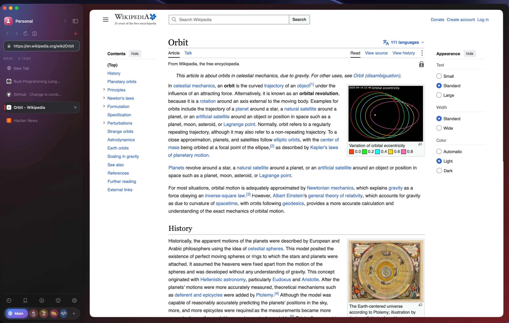

Most browsers treat a window as a strip of tabs. Aether treats it as a **workspace**: your context (a *profile*), the thing you are doing right now (a *space*) and the pages that belong to it (tabs, pinned tabs, split panes) live in one vertical sidebar that tucks away when you want the page to have the room.

It is written in **Swift 6, AppKit and WebKit**. There is no web-based chrome, no bundled engine, no telemetry and no AI. The whole app is a few megabytes, and every pixel of the interface is a native view.

> **Developer preview.** Aether is early software and is shared for testing and feedback. Read [Status and known limits](#status-and-known-limits) before using it for everyday browsing.

---

## Contents

- [Highlights](#highlights)
- [Download and install](#download-and-install)
- [A tour](#a-tour)
- [Everything it does](#everything-it-does)
- [Keyboard shortcuts](#keyboard-shortcuts)
- [Gestures](#gestures)
- [Moving over from another browser](#moving-over-from-another-browser)
- [Privacy](#privacy)
- [Status and known limits](#status-and-known-limits)
- [FAQ](#faq)
- [Feedback](#feedback)
- [Source and licence](#source-and-licence)

---

## Highlights

| | |
| --- | --- |
| **Super lightweight** | A 6.6 MB download, about 9 MB installed. Chromium-based browsers such as Chrome and Dia are over 1 GB because they bundle their own engine; Aether uses the WebKit that is already part of macOS. |
| **Spaces, not tab soup** | Group tabs by what you are doing. Each space has its own glyph, colour and even wallpaper, and the whole sidebar tints to match. |
| **A dock for your spaces** | The active space is a wide pill; the rest are compact orbs. Drag to reorder, swipe to switch. |
| **Profiles that really are separate** | Every profile has its own WebKit data store, so cookies, logins and local storage never cross profile lines. |
| **Split view that behaves** | One to four panes, a picker, drag and drop, a context-menu entry and dividers you can drag. |
| **A collapsed rail** | Fold the sidebar into a slim rail of favicons that still does everything, with the active space always centred. |
| **Type less** | Type `gith` and `hub.com/` fills in, selected, from sites you already visit. |
| **Private browsing** | `⇧⌘N` opens a temporary session that writes nothing to disk. |
| **Yours to style** | Pick a symbol, an emoji or your own image for any space or profile, plus a colour, a second colour and a background. |

---

## Download and install

**Requirements:** a Mac with Apple Silicon and **macOS 14 or later**. The glass surfaces use macOS 26 or later (interactive glass on 27); on older systems Aether falls back to native materials.

1. Open the [Releases](https://github.com/alvinyeboah/aether/releases) page and download the latest `Aether-<version>-arm64.zip`.
2. Compare it with the published checksum: `shasum -a 256 Aether-<version>-arm64.zip` should match the line in [`SHA256SUMS`](SHA256SUMS).
3. Unzip it and drag **Aether.app** into `/Applications`.
4. Open Aether. From 0.4.1 the app is **signed with a Developer ID and notarized by Apple**, so macOS opens it with the usual "downloaded from the internet" confirmation. (0.4.0 and earlier were ad-hoc signed: for those, right-click → Open, or use **Open Anyway** in System Settings → Privacy & Security.)

To make Aether your default browser, open **Settings → General → Default Web Browser**.

> Only download Aether from this repository or the official website, and verify the checksum.

---

## A tour

### The sidebar

Everything sits in one calm column: your profile at the top, navigation and the address field under it, then the tabs in the current space. The active tab is lit; pinned tabs stay put; hovering reveals a close button; the space name and tab count sit above the list.

### Spaces and the space dock

Spaces live in a dock at the bottom of the sidebar. The space you are in is a wide pill with its name; the others shrink to orbs so the dock never gets crowded. If you have many spaces the dock scrolls, with soft fades at the edges, instead of squashing anything.

- Drag an orb to put your spaces in the order you use them.
- In the collapsed rail, swipe sideways with two fingers to move between spaces.
- `⌥⌘→` / `⌥⌘←` step through spaces and `⌥⌘1`–`⌥⌘9` jump straight to one.
- Right-click a tab and use **Move to Space** to send it elsewhere.

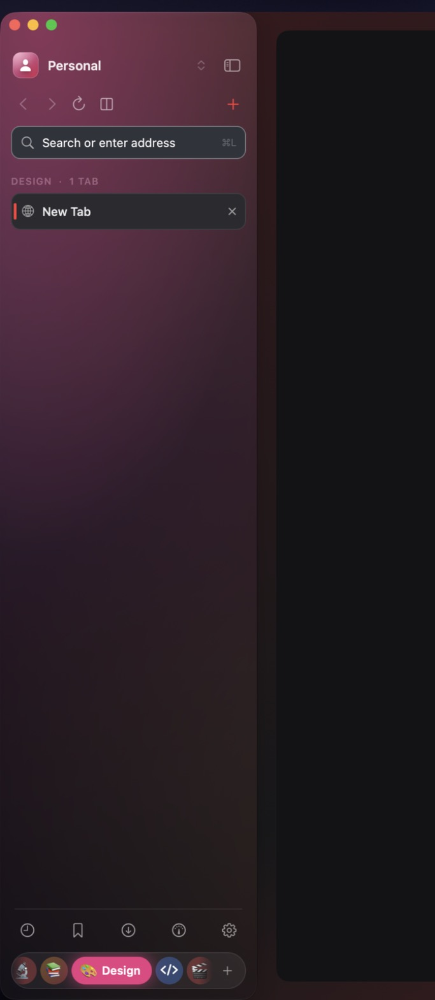 &nbsp; 

### Profiles

Profiles are for separating *contexts*: personal, work, a client. Each one keeps its own cookies, storage and signed-in accounts. Switch from the control at the top of the sidebar; each profile has an avatar you can restyle.

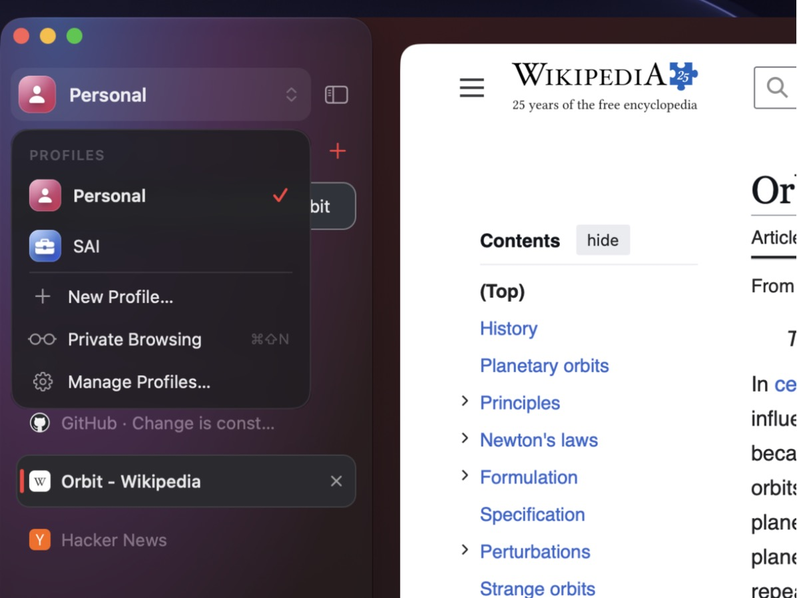

### Make it yours

**Settings → Spaces** lists every space in the current profile. Click the icon to choose a symbol, an emoji or an image from disk; pick a colour (and an optional second colour for a gradient); and set a background image that shows faintly behind the sidebar. Profiles have the same **Icon…** and **Background…** controls. Everything is stored locally and is easy to reset.

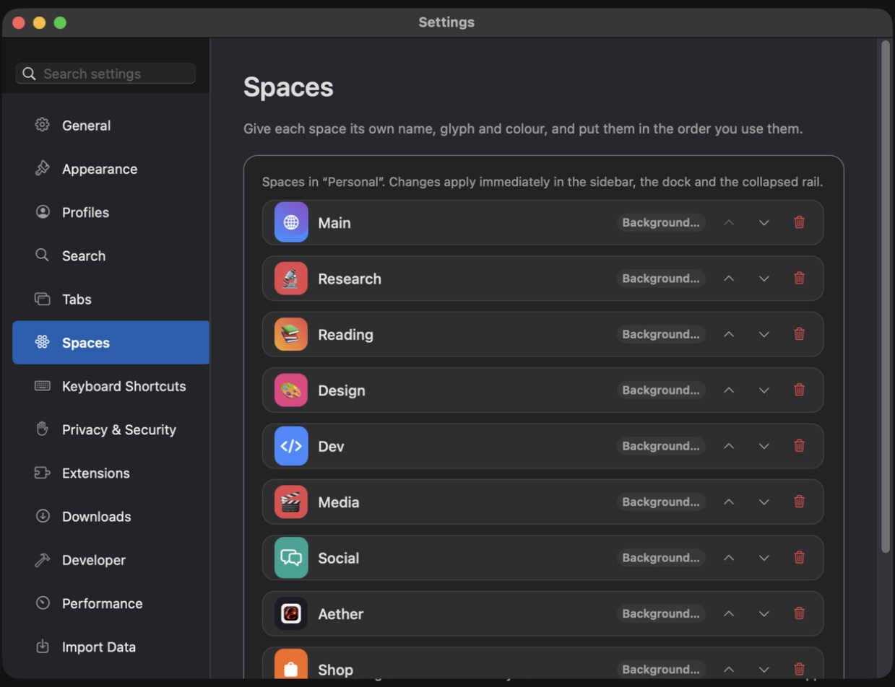

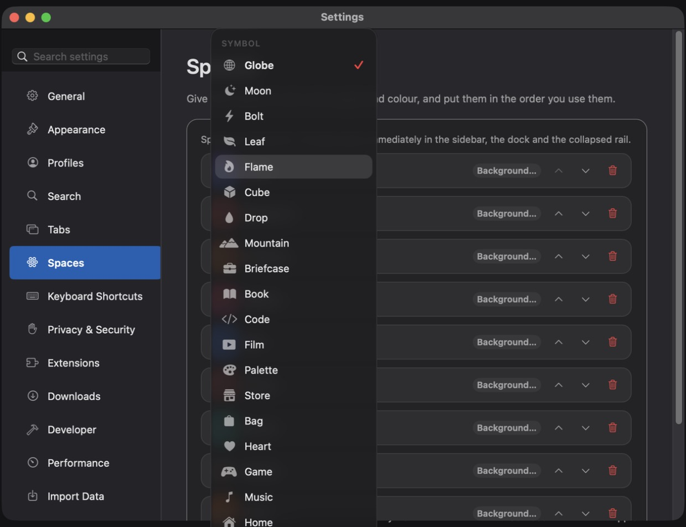 &nbsp; 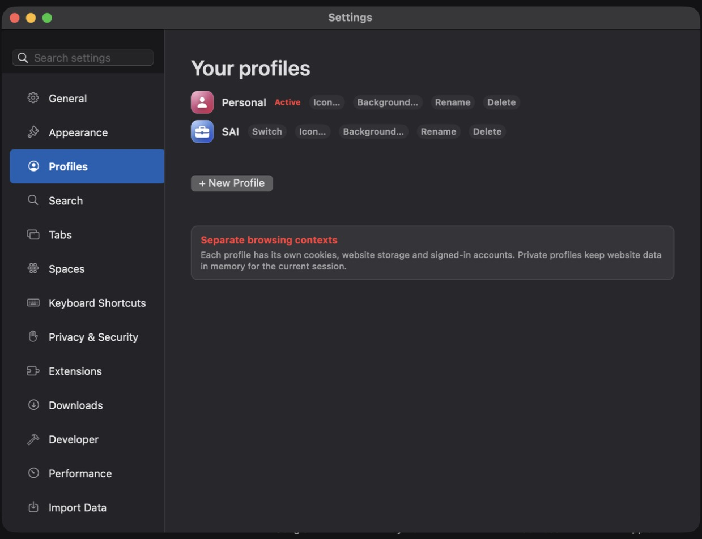

### The collapsed rail

`⌃⌘S` folds the sidebar into a rail. It keeps the profile, navigation, your tabs as favicon tiles (with the close button always visible on the active one), the tools, and a compact dock where the **active space stays in the centre** as you swipe.

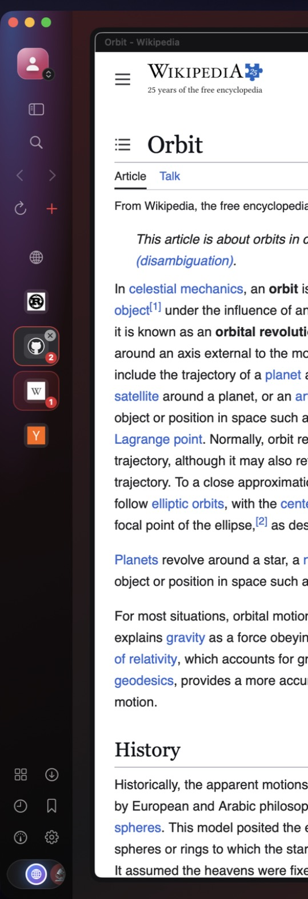

### Split view

Put two to four pages side by side without leaving the window. Start from the split button, from a tab's context menu (**Split Right / Split Left**), or by dragging a tab onto the page. When you start a split, Aether asks which tab goes beside the current one; click it, or press `Esc` to cancel.

- The active pane has a soft ring; the others dim slightly.
- Split tabs get numbered chips in the sidebar so you can see which pane is which.
- Panes start evenly sized; drag the dividers to resize them.
- Corners stay perfectly concentric with the window.

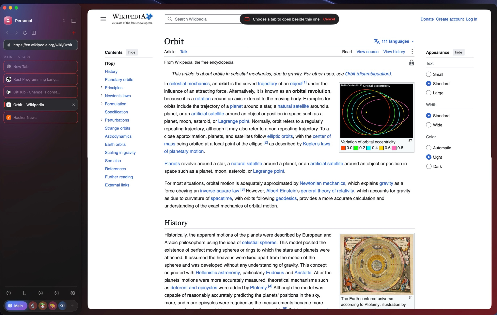 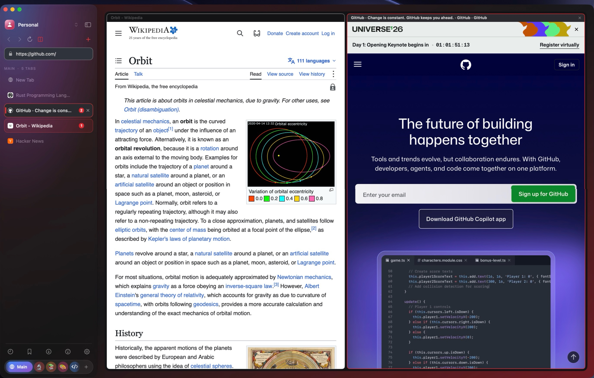

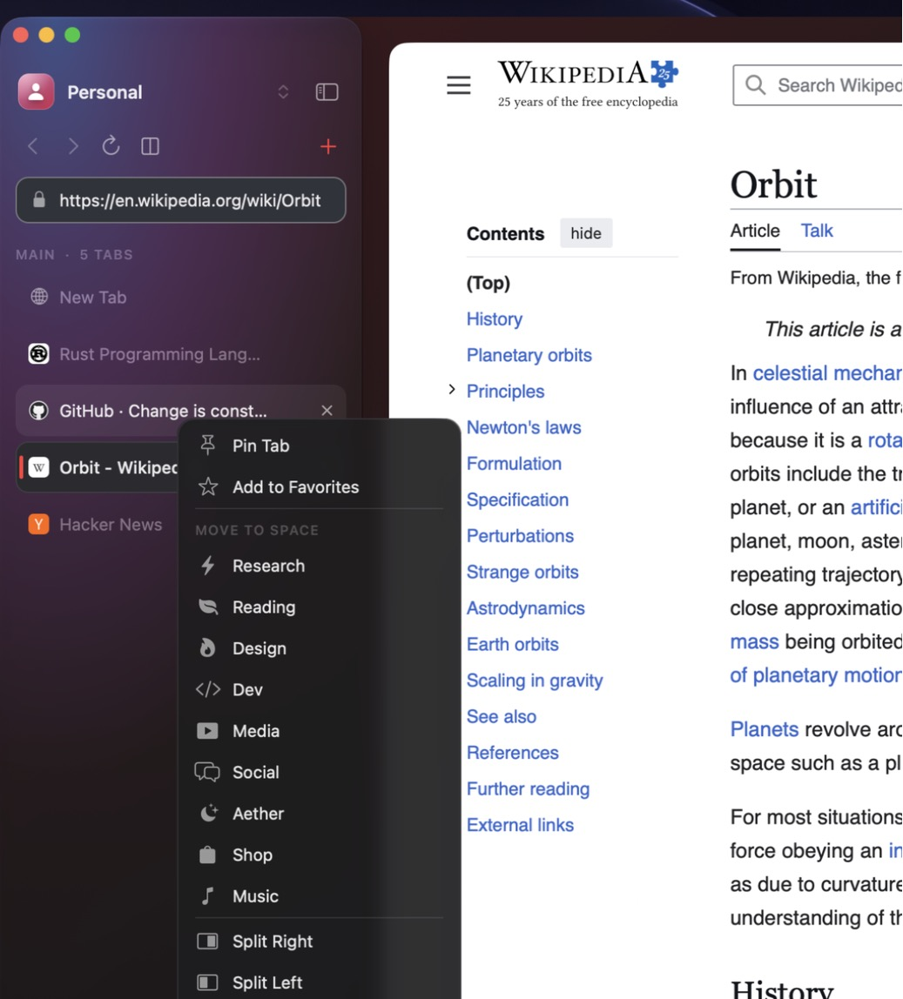

### Address field and suggestions

The address field is also the search field. It completes in place from the sites you actually use, ranks by how often and how recently you visit, and shows a clean list of matches under it. It never interferes while you delete or compose text, and it works the same on the start page and in the sidebar.

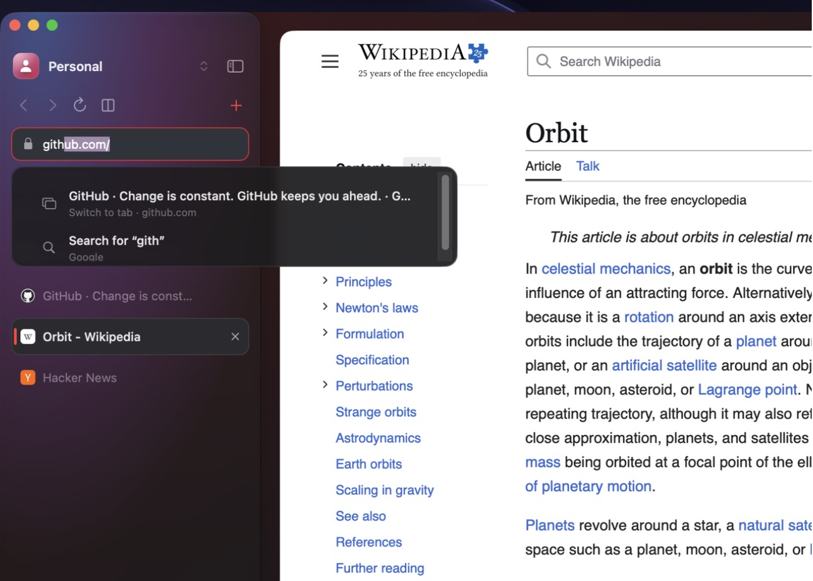

### The start page

A quiet start page with the metallic Aether orbit, one search field, and a grid of the sites you really visit, with their real icons.

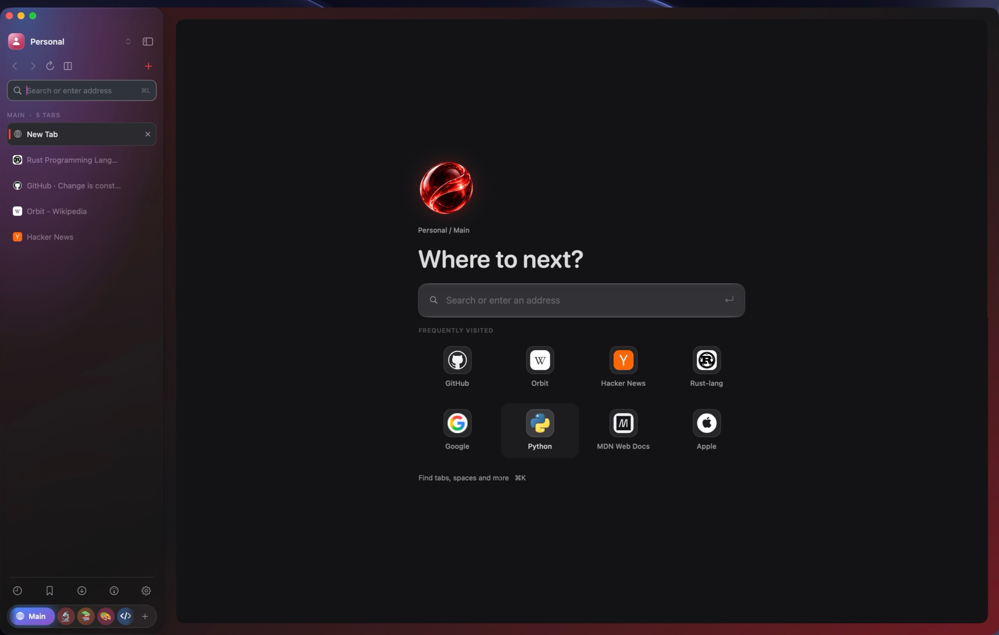

### Private browsing

`⇧⌘N` opens private browsing: a temporary session with its own non-persistent data store. No history, no cookies, no site data and no suggestions from saved data are written to disk. The sidebar turns violet and wears a **PRIVATE** badge so you always know. **Exit Private Browsing** closes every private tab and discards the session.

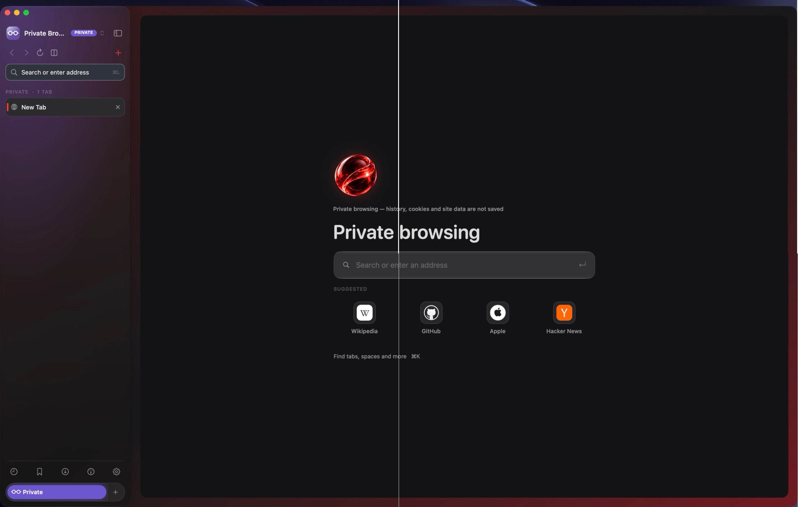

### Keyboard shortcuts, in Settings

**Settings → Keyboard Shortcuts** lists every command, generated live from the menus so it can never fall out of date. The settings window has its own search box.

---

## Everything it does

**Organisation**
- Profiles with real website-data isolation, plus private browsing
- Spaces with custom symbols, emoji, images, colours and backgrounds
- Pinned tabs per space, favourite tabs per profile, collapsible groups
- Tab suspension to save memory; `⇧⌘T` reopens closed tabs
- Split view with one to four panes, a picker, drag and drop, and resizable dividers
- Drag spaces in the dock to reorder them

**Browsing**
- One address and search field with local suggestions and inline URL completion
- Find in page, Reader Mode and a command palette (`⌘K`) that searches tabs, spaces, bookmarks and history
- Page zoom remembered per site, print, save as web archive, and one-key media pause
- Downloads with a popover
- Content blocking, popup blocking and per-site permissions
- Built-in developer tools (`⌥⌘I`) in Chrome's dark style: an editable **Elements** tree with a Styles editor and pick tool, **Network** with a waterfall and Headers / Preview / Response / Timing, and **Application** for cookies, storage, IndexedDB and caches
- A right-click menu in Aether's own design, including **Inspect Element**
- Link peek: ⇧-click a link to preview it in a card, then keep it or dismiss it
- Search inside the pages you have read from the command palette (local, off in private browsing, switchable)
- On-device page translation (`⌃⌘T`, macOS 15+) and picture in picture (`⌃⌘P`)
- One-click `localhost` launchers for common dev-server ports
- A resource monitor showing process memory, CPU and tab states

**Interface**
- Expanded sidebar and a fully functional collapsed rail
- Glass surfaces on macOS 26 and later, native materials before that
- Custom menus, prompts and toasts that match the rest of the app, with Return to confirm and Esc to cancel
- A consistent motion system with Reduce Motion support
- Page scrollbars hidden by default so pages meet the window's rounded corners cleanly (switchable)
- Settings with a search box, a Spaces editor and a live shortcuts reference

**Data**
- Everything is stored locally, per profile
- Bookmarks and history, scoped per profile
- A one-way, additive importer for Safari, Chrome, Arc and Dia bookmarks and history

---

## Keyboard shortcuts

Every shortcut is also in the menus and in **Settings → Keyboard Shortcuts**.

**Tabs and pages**

| Shortcut | Action |
| :-- | :-- |
| `⌘T` | New tab |
| `⇧⌘T` | Reopen closed tab |
| `⌘W` / `⌥⌘W` | Close tab / close other tabs |
| `⌘1`–`⌘8`, `⌘9` | Select tab 1–8 / the last tab |
| `⌃⇥` / `⌃⇧⇥` | Next / previous tab |
| `⌥⌘D` | Duplicate tab |
| `⌥⌘P` | Pin or unpin tab |
| `⌘S` | Save page as a web archive |
| `⌘P` | Print |
| `⌘+` / `⌘-` / `⌘0` | Zoom in / out / actual size |
| `⌥⌘M` | Pause media in this tab |
| `⌘F` | Find in page |
| `⌘R` / `⇧⌘R` / `⌥⌘R` | Reload / reload without cache / Reader Mode |
| `⌘[` / `⌘]` | Back / forward |

**Spaces and layout**

| Shortcut | Action |
| :-- | :-- |
| `⌥⌘→` / `⌥⌘←` | Next / previous space |
| `⌥⌘1`–`⌥⌘9` | Jump to space 1–9 |
| `⌥⌘N` | New space |
| `⌃⌘S` | Collapse or expand the sidebar |
| `⌥⌘S` | Split view: pick a tab, or leave the split |

**Everywhere**

| Shortcut | Action |
| :-- | :-- |
| `⌘L` | Focus the address bar (selects the whole address) |
| `⌘K` | Command palette |
| `⇧⌘N` | Private browsing |
| `⌘Y` / `⌥⌘B` / `⌥⌘L` | History / bookmarks / downloads |
| `⌘D` | Bookmark this page |
| `⌥⌘I` | Developer tools |
| `⇧⌘C` | Select an element on the page |
| `⌃⌘P` | Picture in picture |
| `⌃⌘T` | Translate page / show original |
| `⌥⌘U` | Resource monitor |
| `⌘,` | Settings |

---

## Gestures

- **Swipe between spaces:** two fingers sideways over the collapsed rail (the expanded sidebar leaves sideways swipes alone). Swipe left for the next space, right for the previous; it behaves the same with natural scrolling on or off, and the page slides in the direction you moved. One swipe switches once.
- **Swipe back and forward:** two fingers sideways over a page, with WebKit's native snapshot animation. This can be turned off in **Settings → Tabs**.

Vertical scrolling is never captured, and gestures over a web page stay with the page.

---

## Moving over from another browser

**Settings → Import Data** can bring in bookmarks and history from **Safari, Chrome, Arc and Dia**, so you do not start from zero. Choose a browser, preview what Aether found, and import. Each browser's profiles arrive as separate Aether profiles, imports are additive, repeated imports skip duplicates, and the original browser's data is never modified.

| From | What comes across |
| --- | --- |
| **Safari** | Bookmarks, Favorites, Reading List and history |
| **Chrome** | Bookmarks and history from every Chrome profile |
| **Arc** | History, plus your pinned tabs and folders, grouped by space, as bookmarks |
| **Dia** | Bookmarks and history from every Dia profile |

Importing does **not** move passwords, passkeys, signed-in sessions, cookies, extensions or browser-specific features. History is read from a copy, so the other browser can stay open. macOS protects Safari's data folder: if the Safari preview comes back empty, use **Choose Folder…** and select `~/Library/Safari`, or give Aether Full Disk Access in System Settings → Privacy & Security.

---

## Privacy

- **No telemetry, no analytics, no accounts.** Aether does not phone home.
- **Local by default.** Tabs, history, bookmarks and settings live in your own `Library/Application Support/Aether` folder; web data lives in per-profile WebKit stores.
- **Isolated profiles.** Cookies and site storage are never shared between profiles.
- **Private browsing is memory-only.** It uses a non-persistent data store and clears when you exit.
- **Your search engine's rules apply.** Searches go to the search engine you chose (Google by default); Aether does not add its own services.

---

## Status and known limits

Aether is a **developer preview**, built by one person. It is good enough to try and to give feedback on, but it is not a finished browser.

- **Signed and notarized, without passkeys.** 0.4.1 is signed with a Developer ID and notarized by Apple. It does not yet have the Apple browser passkey capability (requested, awaiting Apple).
- **Passkeys and iCloud Passwords.** Browser access to iCloud passkeys needs an Apple-granted entitlement that has not been enabled in public builds yet, so automatic iCloud password filling and passkey sign-in are **not verified**. Sites that use their own password fields work normally.
- **Apple Silicon only** for now.
- **No sync.** There is no cloud sync between Macs.
- **Extensions.** WebExtensions support is limited and experimental.
- **Importing** covers readable bookmarks and history only.
- **Not hardened for high-risk use.** Aether uses WebKit, so it receives WebKit and macOS security updates, but treat a preview as a preview.

---

## FAQ

**Is Aether open source?**
No. The application source is private; this repository is for downloads, release notes and feedback. All rights reserved.

**Which engine does it use?**
Apple's WebKit (`WKWebView`), the same engine as Safari. Sites that work in Safari work here.

**Why is there a security prompt when I open it?**
Only the older 0.3.x and 0.4.0 downloads are ad-hoc signed; for those, right-click → Open, or use **Open Anyway** in System Settings → Privacy & Security. 0.4.1 and later are notarized and open normally.

**Does it work on Intel Macs or Windows?**
Not currently. It is built for Apple Silicon and macOS 14 or later.

**Will my Chrome or Safari extensions work?**
No. Aether has an early WebExtensions implementation, not full Chrome or Safari extension compatibility.

**Does it have AI features?**
No. That is deliberate.

**How do I reset a space or profile icon?**
Open **Settings → Spaces** (or **Profiles**), click the icon (or **Icon…**) and choose **Reset icon**; the same menu has **Reset colours**, and **Background…** has **Remove wallpaper**.

**Where does Aether keep my data?**
In `~/Library/Application Support/Aether`. Quit Aether and delete that folder to start completely fresh.

**How do I report a bug?**
Open an [issue](https://github.com/alvinyeboah/aether/issues/new/choose) with the version, your macOS version and the steps to reproduce it.

---

## Feedback

Use [Issues](https://github.com/alvinyeboah/aether/issues) for bugs and feature requests. Please include:

- the Aether version (**Aether → About Aether**) and your macOS version,
- what you did, what you expected and what happened instead,
- a screenshot if it is a visual problem.

Please do **not** post passwords, access tokens, private browsing history or screenshots of your accounts.

---

## Source and licence

Aether is **closed source**. This repository holds public release information, downloads and feedback, not the application source. © Alvin Yeboah. All rights reserved.

macOS, Safari, WebKit and Apple Silicon are trademarks of Apple Inc. Aether is an independent project and is not affiliated with or endorsed by Apple, Google, Wikipedia, GitHub or any other site shown in screenshots.
